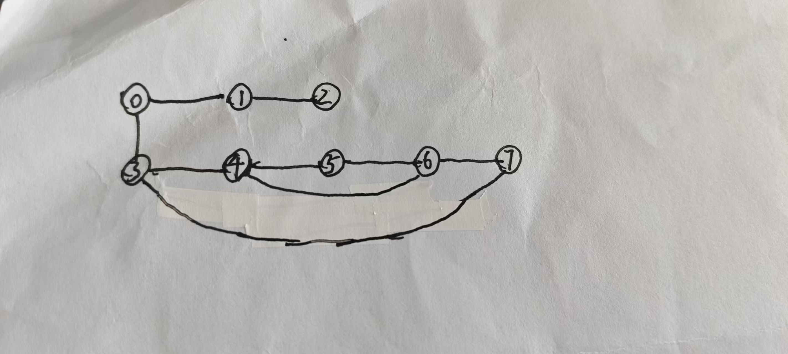

# `deque`和`queue`

在算法竞赛中，**队列（Queue）**和**双端队列（Deque）**是两种常用的数据结构，它们在性质和用途上既有联系也有区别。**队列**遵循先进先出（FIFO）原则，仅允许在一端（队尾）插入元素、在另一端（队头）删除元素。而**双端队列**则支持在两端高效地插入和删除元素，既可以向头部插入元素，也可以向尾部插入元素，非常灵活。

**主要区别**在于：C++ STL 中的 `std::queue` 并非独立容器，而是一个**容器适配器**，它通过封装一个底层容器（默认使用 `std::deque`）来提供队列接口。`std::queue` 仅暴露 `push`（入队，相当于 `push_back`）、`pop`（出队，相当于 `pop_front`）、`front`（获取队头元素）和 `back`（获取队尾元素）等有限操作，严格禁止随机访问或遍历队列中间元素。相比之下，`std::deque` 是一个**序列容器**，提供两端操作以及随机访问能力，可以像遍历数组一样遍历其元素。简单来说，可以将 `std::queue` 看作对 `std::deque` 功能的**封装和限制**。当需要队列的 FIFO 行为且无需访问中间元素时，使用 `std::queue` 可提高代码的语义安全性和可读性；而当需要两端操作或随机访问能力时，则应使用 `std::deque`。

<hr />

## Queue 模板与示例：FIFO 队列的应用

### 1. `std::queue` 的基本操作

下面的代码演示了 `std::queue` 的基本用法，包括入队、出队、获取队头和队尾元素等操作。注意，由于 `std::queue` 没有提供迭代器接口，我们无法直接遍历队列中的所有元素。如果需要查看队列内容，通常需要逐个出队处理。
```cpp
#include<iostream>
#include<queue>
using namespace std;

int main(){
    queue<int> q;

    //入队操作
    q.push(10);
    q.push(5);

    //获取队头和队尾元素
    cout << "队头元素: " << q.front() << endl;  // 输出 10
    cout << "队尾元素: " << q.back() << endl;    // 输出 5

    // 出队操作（删除队头元素）
    q.pop();
    cout << "出队后新的队头元素: " << q.front() << endl;  // 输出 5

    return 0;
}
```
**输出**：
```txt
队头元素: 10
队尾元素: 5
出队后新的队头元素: 5
```

<br />

### 2.BFS 寻找最短路径（无权图）

**广度优先搜索 (BFS)** 是队列最常见的应用场景。在无权图中寻找最短路径或层级遍历时，BFS 利用队列按层次顺序访问节点。具体做法是将起始节点入队，然后不断从队头取出节点处理，并将其未访问的邻接节点入队。这样，每个节点都会按照距离起点的层级顺序被访问，最先到达的节点最先被处理，符合 FIFO 特性。

下面的代码展示了使用 BFS 求解**无权图最短路径**的模板，以二维网格中的迷宫问题为例（将网格视为图，每个格子是一个节点，上下左右移动是边，边权均为1）。该算法也可用于其他无权图最短路径问题，如社交网络中的最短好友路径等。
```cpp
#include <iostream>
#include <queue>
#include <vector>
#include <algorithm>
using namespace std;

/**
 *  @note
 *    每个BFSResult存放的都是从某个固定的点到其他所有点的距离，以及相应的前驱节点。
 *    因此，当更换出发点时，如果采用一个固定的result，则该result会被刷新，所以需要将先前的路径单独采用一个vector保存。
 */
struct BFSResult {
    vector<int> distance;                             //distance[i] = 从起点到节点i的最短距离，-1表示不可达
    vector<int> parent;                               //parent[i] = 节点i在最短路径树中的前驱，-1表示无前驱
};

/**
 *  @brief bfsShortestPath - BFS最短路径算法
 *  @param {vector<vector<int>>} graph - 图的数组
 *  @param {int} source - 遍历起点
 *  @return {BFSResult} result - BFS遍历结果
 */
BFSResult bfsShortestPath(const vector<vector<int>>& graph,int source){
    int n=graph.size();                                   //n表示图中节点数量
    BFSResult result;                                     //result是从source出发遍历的最终结果
    result.distance.assign(n,-1);                         //初始化到所有点的距离为-1，即所有点不可达
    result.parent.assign(n,-1);                           //初始化所有点的前向节点为-1，即所有点初始均没有前向节点

    queue<int> q;                                         //采用队列形式进行处理
    result.distance[source]=0;                            //出发点到自身距离为0
    q.push(source);                                       //出发点入队

    while(!q.empty()){                                    //当队列非空
        int u=q.front();                                  //获取到队首的元素
        q.pop();                                          //弹出队首元素

        //遍历u的所有邻居
        for(int v:graph[u]){
            if(result.distance[v]==-1){                  //如果v之前不可达，则更新v的状态为u+1
                result.distance[v]=result.distance[u]+1;
                result.parent[v]=u;                      //将v的前向节点设置为u
                q.push(v);                               //将v入栈
            } 
        }
    }

    return result;                                       //返回最终结果
}

/**
 *  @brief restorePath - 从store到target的最短路径
 *  @param {int} source - 出发点
 *  @param {int} target - 终点
 *  @param {vector<int>} parent - 遍历结束后的前驱节点数组
 *  @return {vector<int>} path - 最终的路径数组
 */
vector<int> restorePath(int source,int target,const vector<int>& parent){
    //如果目标节点无前驱节点，且目标节点不是出发点，则表明该节点不可达，返回空vector
    if(parent[target]==-1&&source!=target){
        return {};
    }

    vector<int> path;                                         //采用vector存放最终结果
    for(int v=target;v!=-1;v=parent[v]){                      //从v开始，依次倒序遍历
        path.push_back(v);                                    //每次都将遍历到的节点加入path
    }

    reverse(path.begin(),path.end());                         //将最终结果翻转，从而保证出发点在前
    return path;                                              //返回最终结果
}

/**
 *  @brief printResult - 输出路径
 *  @param {BFSResult} result - 遍历后得到的结果
 *  @param {int} source - 出发点
 *  @return 无
 */
void printResult(const BFSResult& result,int source){
    cout<<"从节点 "<<source<<" 出发的最短路径信息："<<endl;                    //输出标题和表头
    cout<<"节点\t距离\t前驱\t路径"<<endl;

    for(int i=0;i<result.distance.size();i++){                              //依次遍历图中所有节点
        cout<<i<<"\t";

        if(result.distance[i]==-1){
            cout<<"不可达\t-\t-"<<endl;                                     //当节点不可达时，输出对应的结果
        }else{
            cout<<result.distance[i]<<"\t";                                //当节点可达时，输出距离和前驱节点
            cout<<result.parent[i]<<"\t";

            //打印路径
            vector<int> path=restorePath(source,i,result.parent);          //采用path保存从出发点到单个具体节点的路径
            for(int j=0;j<path.size();j++){                                //输出具体路径
                if(j>0) cout<<"->";
                cout<<path[j];
            }
            cout<<endl;
        }
    }
}

int main(){
    int n=8;
    vector<vector<int>> graph(n);                                    //采用二维vector存图

    //添加边（无向图）
    auto addEdge=[&](int u,int v){
        //双端均可达
        graph[u].push_back(v);
        graph[v].push_back(u);
    }

    addEdge(0, 1);
    addEdge(0, 3);
    addEdge(1, 2);
    addEdge(3, 4);
    addEdge(3, 7);
    addEdge(4, 5);
    addEdge(4, 6);
    addEdge(4, 7);
    addEdge(5, 6);
    addEdge(6, 7);

    int source=0;                                                       //设定出发点为0
    BFSResult result=bfsShortestPath(graph,source);                     //从0出发，获取到遍历结果

    printResult(result,source);                                         //输出结果

    //特别测试到节点7的路径
    cout<<"\n特别测试：从节点0到节点7的最短路径"<<endl;
    vector<int> path=restorePath(source,7,result.parent);
    cout<<"最短距离："<<result.distance[7]<<endl;
    cout<<"最短路径：";
    for(int i=0;i<path.size();i++){
        if(i>0) cout<<"->";
        cout<<path[i];
    }
    cout<<endl;

    return 0;
}
```
<br />

**图示**：


<br />

**输出示例：**
```txt
从节点 0 出发的最短路径信息：
节点    距离    前驱    路径
0       0       -1      0
1       1       0       0->1
2       2       1       0->1->2
3       1       0       0->3
4       2       3       0->3->4
5       3       4       0->3->4->5
6       3       4       0->3->4->6
7       2       3       0->3->7

特别测试：从节点0到节点7的最短路径
最短距离: 2
最短路径: 0->3->7
```

<br />

**算法正确性分析：**

**BFS 最短路径算法的正确性基于以下关键性质**：

1. **分层性质**：BFS 按层遍历，第`k`层的节点距离起点恰好为`k`
2. **首次访问即最短**：节点第一次被访问时，得到的距离就是最短距离
3. **前驱数组构建路径树**：`parent`数组构建了一棵最短路径树，可以重建任意节点的最短路径

**正确性证明要点**：
- 当节点`v`首次被访问时，它是通过距离为`d`的节点`u`发现的
- 由于BFS按层遍历，任何距离小于`d`的节点都已经被处理过
- 如果存在更短的路径，`v`应该在更早的层就被发现，与"首次访问"矛盾
- 因此`distance[v] = d+1`确实是`v`的最短距离

<br />

### 3.BFS统计连通分量

另一个常见的 BFS 应用是**统计连通分量**。例如，在无向图中找出有多少个连通子图，或者在网格中找出有多少个独立的“岛屿”。下面的代码展示了使用 BFS 统计网格中岛屿数量的模板。该模板也可用于社交网络中找朋友圈数量等场景。
```cpp
#include <iostream>
#include <vector>
#include <queue>
using namespace std;

//定义方向数组，用于上下左右移动
const int dx[]={-1,1,0,0};
const int dy[]={0,0,-1,1};

/**
 *  @brief bfs - 广度优先遍历
 *  @param {vector<vector<char>>} grid - 遍历的图
 *  @param {int} x - 出发点横坐标
 *  @param {int} y - 出发点纵坐标
 *  @return 无
 */
void bfs(vector<vector<char>>& grid,int x,int y){
    int rows=grid.size();                                     //行数
    int cols=grid[0].size();                                  //列数

    queue<pair<int,int>> q;                                   //采用队列q进行处理
    q.push({x,y});                                            //出发点坐标入队
    grid[x][y]='0';                                           //标记为已访问

    while(!q.empty()){
        auto [curX,curY]=q.front();                           //获取到队首的横纵坐标
        q.pop();                                              //队首元素出队

        //遍历四个方向
        for(int i=0;i<4;i++){
            int nx=curX+dx[i];
            int ny=curY+dy[i];

            //如果遍历到的点位于图内，且该节点为1
            if(nx>=0&&nx<rows&&ny>=0&&ny<cols&&grid[nx][ny]=='1'){
                grid[nx][ny]='0';                              //标记为0
                q.push({nx,ny});                               //入队
            }
        }
    }
}

/**
 *  @brief numIslands - 岛屿数量计算函数
 *  @param {vector<vector<char>>} - 遍历的图
 *  @return {int} count - 岛屿数量
 */
int numIslands(vector<vector<char>>& grid){
    //如果图为空，直接返回0
    if(grid.empty()) return 0;

    int rows=grid.size();                                      //行数
    int cols=grid[0].size();                                   //列数
    int count=0;                                               //岛屿数量

    for(int i=0;i<rows;i++){
        for(int j=0;j<cols;j++){
            if(grid[i][j]=='1'){
                //发现一座岛屿，使用bfs标记整座岛屿
                bfs(grid,i,j);
                count++;                                       //更新岛屿数量
            }
        }
    }

    return count;                                              //返回最终结果
}

int main(){
    vector<vector<char>> grid={
        {'1', '1', '0', '0', '0'},
        {'1', '1', '0', '0', '0'},
        {'0', '0', '1', '0', '0'},
        {'0', '0', '0', '1', '1'}
    };

    cout<<"岛屿数量："<<numIslands(grid)<<endl;

    return 0;
}
```

<br />

**输出示例**：
```txt
岛屿数量: 3
```

<hr />

## Deque 模板与示例：双端队列的高级应用

### 1.`std::deque`的基本操作

`std::deque` 提供了比 `std::queue` 更丰富的接口，包括 `push_back`、`push_front`、`pop_back`、`pop_front`，以及 `front`、`back` 等。此外，`std::deque` 支持随机访问，可以通过 `dq[i]` 或迭代器访问元素。下面的代码演示了 `std::deque` 的基本用法。
```cpp
#include <iostream>
#include <deque>
using namespace std;

int main(){
    deque<int> dq;

    // 在双端队列的两端插入元素
    dq.push_back(10);     // 在队尾插入10
    dq.push_front(20);    // 在队头插入20
    dq.push_back(30);     // 在队尾插入30
    dq.push_front(5);     // 在队头插入5

    // 遍历双端队列
    cout << "双端队列元素: ";
    for (int val : dq) {
        cout << val << " ";
    }
    cout << endl;

    // 获取队头和队尾元素
    cout << "队头元素: " << dq.front() << endl;  // 输出 5
    cout << "队尾元素: " << dq.back() << endl;    // 输出 30

    // 从两端删除元素
    dq.pop_front();  // 删除队头元素5
    dq.pop_back();   // 删除队尾元素30

    cout << "删除两端元素后: ";
    for (int val : dq) {
        cout << val << " ";
    }
    cout << endl;

    return 0;
}
```

**输出**：
```txt
双端队列元素: 5 20 10 30 
队头元素: 5
队尾元素: 30
删除两端元素后: 20 10 
```

<br />

### 2.滑动窗口最大值（单调队列）

**单调队列**是双端队列在算法竞赛中的一个高级应用，用于在 O(n) 时间内解决**滑动窗口最值**问题。给定一个数组和一个窗口大小 k，要求输出每个窗口内的最大值或最小值。暴力做法对于每个窗口重新计算极值，时间复杂度为 O(n × k)。而使用单调队列可以在线性时间内完成：维护一个存储**候选元素下标**的 `deque`，保证队列内对应的元素值保持单调有序（求最大值时单调递减，求最小值时单调递增）。在遍历数组过程中，每当窗口滑动时，执行以下步骤：

1. 从队头移除已经滑出窗口范围的元素下标（即队列头部的下标小于当前窗口起始位置）。
2. 从队尾移除所有值**小于等于**当前新元素的元素下标（因为这些旧元素永远不可能成为后续窗口的最大值，可以被新元素替代）。
3. 将当前元素下标插入队尾。
4. 此时，队头下标所对应的元素即为当前窗口的极值（最大值或最小值），记录结果。

通过上述操作，单调队列保证了队列始终包含**可能成为窗口最值的候选**，并且队头始终是当前窗口的最值。由于每个元素最多被插入和删除一次，整个过程的时间复杂度为 O(n)。这种技术在解决**滑动窗口最大值**（LeetCode 239）等经典问题时非常高效。

下面的代码实现了滑动窗口最大值的求解，并输出每个窗口的最大值。
```cpp

```